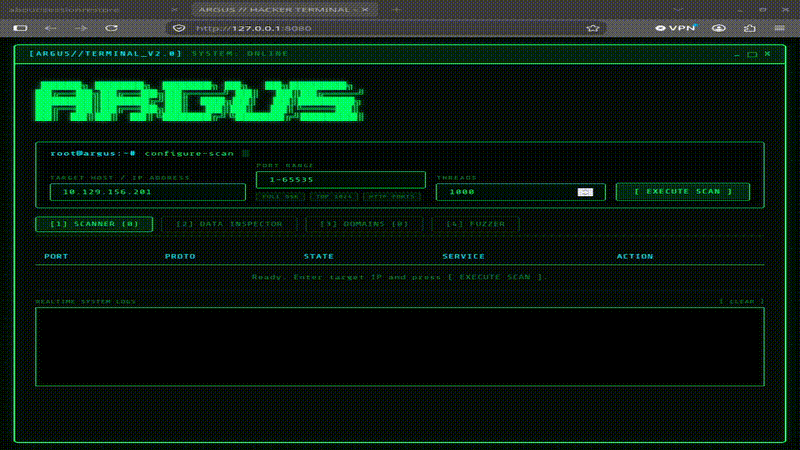

# ARGUS - CTF Reconnaissance Tool



ARGUS is a high-speed reconnaissance tool designed specifically for CTF (Capture The Flag) competitions and security assessments. Its primary goal is to streamline and accelerate the initial enumeration workflow by combining ultra-fast TCP port scanning (RustScan style), detailed service and OS fingerprinting (Nmap inspection engine), automated domain discovery with `/etc/hosts` mapping, and parallel endpoint directory fuzzing (GoBuster style) into a single standalone hacker terminal interface.

---

## Key Features

- **High-Speed Port Scanner**: Scans all 65,535 TCP ports in seconds using a high-concurrency Go worker pool.
- **Data Inspector Engine**: Automatically triggers Nmap (`-sV -sC`) on discovered open ports to gather critical service versions, OS details, and banner information.
- **Domains & Host Mapping**: Analyzes HTTP/HTTPS services, SSL/TLS certificates (Common Name, SANs), headers, and HTML content to identify domain names pointing to the target IP, offering one-click `/etc/hosts` additions (`echo "IP domain" | sudo tee -a /etc/hosts`).
- **Endpoint Fuzzer**: Brute-forces web directories and files with custom wordlists, status code filtering, and extension support.
- **Standalone Hacker Terminal**: Operates as a dedicated, standalone desktop application featuring a dark phosphor-green cyberpunk terminal interface.

---

## Modular Architecture

The project is structured cleanly into decoupled packages:

```
Argus/
├── main.go            - Application entry point
├── scanner/           - Fast TCP port scanner, Nmap engine, domain & hosts helpers
├── fuzzing/           - Parallel HTTP directory fuzzer (GoBuster style)
├── ui/                - Desktop application window server & hacker terminal UI
└── demo.gif           - Demonstration preview
```

---

## Requirements

- Go 1.21 or higher
- Nmap (optional, for detailed service fingerprinting)
- Linux / macOS / Windows desktop environment

---

## Installation & Usage

1. Clone the repository:
   ```bash
   git clone https://github.com/LaurentiuTopai/Argus.git
   cd Argus
   ```

2. Build the binary:
   ```bash
   go build -o argus main.go
   ```

3. Launch the application:
   ```bash
   ./argus
   ```

Executing `./argus` automatically launches the standalone hacker terminal application window.

---

## License

This project is open-source and intended for security research, educational purposes, and CTF competitions.
